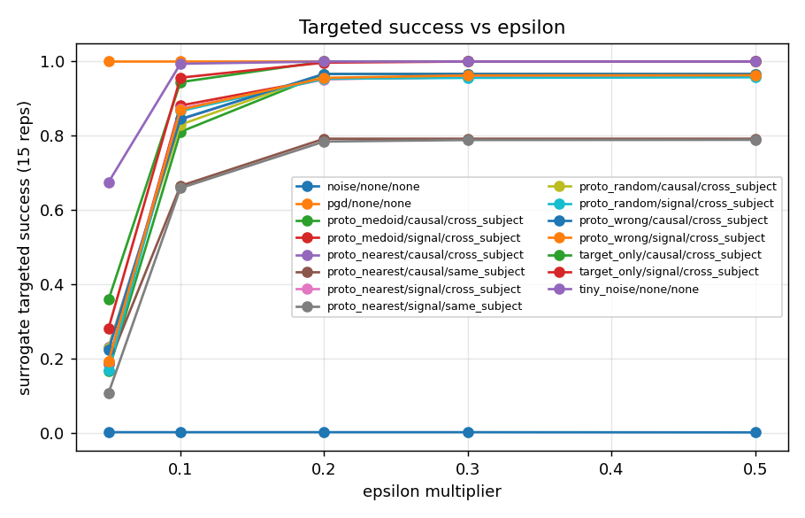
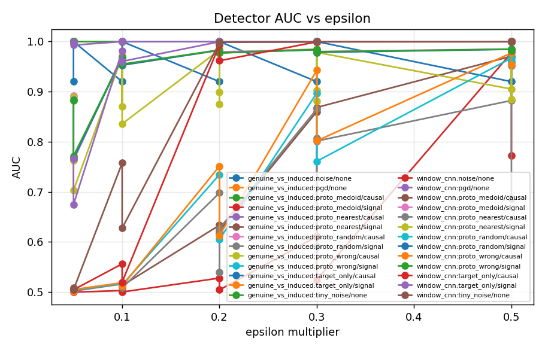
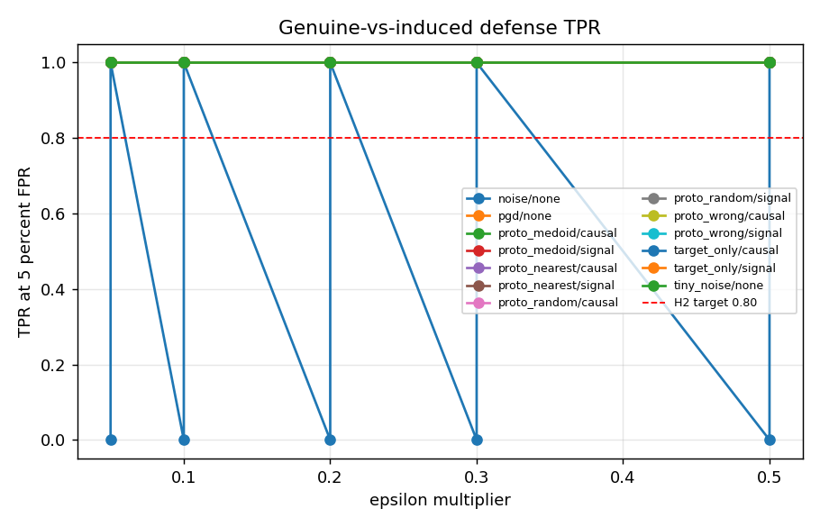

# Kill-test report

Output root: `kaggle/out/kill_test_merged_20260929/out/kill_test`

## Clean decoder accuracy

| subject | model | seed | val_auc | test_flash_auc | test_letter_acc_15reps | test_letter_acc_5reps | n_test_trials |
| --- | --- | --- | --- | --- | --- | --- | --- |
| A | deepconvnet | 0 | 0.8019 | 0.7712 | 0.98 | 0.65 | 100 |
| A | deepconvnet | 1 | 0.7971 | 0.7708 | 0.98 | 0.69 | 100 |
| A | deepconvnet | 2 | 0.799 | 0.7666 | 0.95 | 0.56 | 100 |
| A | eegnet | 0 | 0.7909 | 0.7689 | 0.96 | 0.63 | 100 |
| A | eegnet | 1 | 0.7928 | 0.7674 | 0.96 | 0.62 | 100 |
| A | eegnet | 2 | 0.7991 | 0.7732 | 0.99 | 0.68 | 100 |
| A | shallowconvnet | 0 | 0.7279 | 0.7034 | 0.79 | 0.47 | 100 |
| A | shallowconvnet | 1 | 0.735 | 0.7045 | 0.76 | 0.46 | 100 |
| A | shallowconvnet | 2 | 0.7258 | 0.701 | 0.87 | 0.48 | 100 |
| A | xdawn_lda | 0 | 0.7673 | 0.7541 | 0.95 | 0.59 | 100 |
| A | xdawn_lda | 1 | 0.7673 | 0.7541 | 0.95 | 0.59 | 100 |
| A | xdawn_lda | 2 | 0.7673 | 0.7541 | 0.95 | 0.59 | 100 |
| B | deepconvnet | 0 | 0.9045 | 0.8473 | 0.99 | 0.88 | 100 |
| B | deepconvnet | 1 | 0.9087 | 0.8556 | 0.98 | 0.87 | 100 |
| B | deepconvnet | 2 | 0.9038 | 0.855 | 0.99 | 0.88 | 100 |
| B | eegnet | 0 | 0.8996 | 0.8419 | 0.97 | 0.81 | 100 |
| B | eegnet | 1 | 0.8972 | 0.8382 | 0.97 | 0.82 | 100 |
| B | eegnet | 2 | 0.8993 | 0.8388 | 0.96 | 0.8 | 100 |
| B | shallowconvnet | 0 | 0.8614 | 0.8154 | 0.96 | 0.79 | 100 |
| B | shallowconvnet | 1 | 0.8609 | 0.8151 | 0.95 | 0.8 | 100 |
| B | shallowconvnet | 2 | 0.8587 | 0.8277 | 0.96 | 0.81 | 100 |
| B | xdawn_lda | 0 | 0.8826 | 0.8267 | 0.99 | 0.77 | 100 |
| B | xdawn_lda | 1 | 0.8826 | 0.8267 | 0.99 | 0.77 | 100 |
| B | xdawn_lda | 2 | 0.8826 | 0.8267 | 0.99 | 0.77 | 100 |

## Targeted success vs epsilon (surrogate and victims)

Each row is one epsilon. Surrogate success is the matching axis; victim columns report transfer at the same epsilon.

| subject | method | generator | bank | eps_multiplier | success_surrogate_15 | success_deepconvnet_15 | success_shallowconvnet_15 | success_xdawn_lda_15 | linf | l2 | rms | snr_db |
| --- | --- | --- | --- | --- | --- | --- | --- | --- | --- | --- | --- | --- |
| A | noise | none | none | 0.05 | 0.002 | 0 | 0.004 | 0.003 | 1.014 | 147.6 | 0.209 | 36.33 |
| A | noise | none | none | 0.1 | 0.002 | 0 | 0.005 | 0.003 | 2.028 | 295.2 | 0.418 | 30.31 |
| A | noise | none | none | 0.2 | 0.002 | 0 | 0.005 | 0.003 | 4.056 | 590.4 | 0.8359 | 24.29 |
| A | noise | none | none | 0.3 | 0.002 | 0 | 0.004 | 0.003 | 6.084 | 885.6 | 1.254 | 20.76 |
| A | noise | none | none | 0.5 | 0.001 | 0.001 | 0.002 | 0.003 | 10.14 | 1476 | 2.09 | 16.33 |
| A | pgd | none | none | 0.05 | 1 | 1 | 0.924 | 1 | 1.014 | 713.7 | 1.01 | 22.63 |
| A | pgd | none | none | 0.1 | 1 | 1 | 1 | 1 | 2.028 | 1424 | 2.017 | 16.62 |
| A | pgd | none | none | 0.2 | 1 | 1 | 1 | 1 | 4.056 | 2843 | 4.025 | 10.62 |
| A | pgd | none | none | 0.3 | 1 | 1 | 1 | 1 | 6.084 | 4249 | 6.016 | 7.131 |
| A | pgd | none | none | 0.5 | 1 | 1 | 1 | 1 | 10.14 | 6378 | 9.031 | 3.603 |
| A | proto_medoid | causal | cross_subject | 0.05 | 0.24 | 0.129 | 0.037 | 0.195 | 0.9836 | 149.7 | 0.2119 | 40.86 |
| A | proto_medoid | causal | cross_subject | 0.1 | 0.883 | 0.703 | 0.168 | 0.807 | 1.967 | 299.4 | 0.424 | 35.02 |
| A | proto_medoid | causal | cross_subject | 0.2 | 0.97 | 0.97 | 0.712 | 0.97 | 3.934 | 592.7 | 0.8393 | 29.26 |
| A | proto_medoid | causal | cross_subject | 0.3 | 0.97 | 0.97 | 0.907 | 0.97 | 5.901 | 784.7 | 1.111 | 26.9 |
| A | proto_medoid | causal | cross_subject | 0.5 | 0.97 | 0.97 | 0.954 | 0.97 | 9.836 | 992 | 1.405 | 24.93 |
| A | proto_medoid | signal | cross_subject | 0.05 | 0.29 | 0.166 | 0.023 | 0.175 | 0.9836 | 464.5 | 0.6577 | 31.3 |
| A | proto_medoid | signal | cross_subject | 0.1 | 0.91 | 0.779 | 0.119 | 0.83 | 1.967 | 905.3 | 1.282 | 25.68 |
| A | proto_medoid | signal | cross_subject | 0.2 | 0.97 | 0.97 | 0.628 | 0.97 | 3.934 | 1702 | 2.409 | 20.37 |
| A | proto_medoid | signal | cross_subject | 0.3 | 0.97 | 0.97 | 0.878 | 0.97 | 5.901 | 2376 | 3.365 | 17.56 |
| A | proto_medoid | signal | cross_subject | 0.5 | 0.97 | 0.97 | 0.924 | 0.97 | 9.836 | 3434 | 4.862 | 14.46 |
| A | proto_nearest | causal | cross_subject | 0.05 | 0.368 | 0.215 | 0.045 | 0.305 | 0.9836 | 158.2 | 0.2241 | 40.39 |
| A | proto_nearest | causal | cross_subject | 0.1 | 0.947 | 0.852 | 0.243 | 0.917 | 1.967 | 315.3 | 0.4465 | 34.58 |
| A | proto_nearest | causal | cross_subject | 0.2 | 0.97 | 0.97 | 0.827 | 0.97 | 3.934 | 601.1 | 0.8511 | 29.14 |
| A | proto_nearest | causal | cross_subject | 0.3 | 0.97 | 0.97 | 0.906 | 0.97 | 5.901 | 708.9 | 1.004 | 27.75 |
| A | proto_nearest | causal | cross_subject | 0.5 | 0.97 | 0.97 | 0.943 | 0.97 | 9.836 | 899.9 | 1.274 | 25.74 |
| A | proto_nearest | causal | same_subject | 0.05 | 0.304 | 0.181 | 0.047 | 0.25 | 0.8153 | 130.9 | 0.1854 | 67.66 |
| A | proto_nearest | causal | same_subject | 0.1 | 0.784 | 0.712 | 0.23 | 0.753 | 1.631 | 262 | 0.371 | 62.82 |
| A | proto_nearest | causal | same_subject | 0.2 | 0.804 | 0.804 | 0.733 | 0.804 | 3.261 | 518.5 | 0.7341 | 58.05 |
| A | proto_nearest | causal | same_subject | 0.3 | 0.804 | 0.804 | 0.794 | 0.804 | 4.892 | 667.6 | 0.9453 | 56.28 |
| A | proto_nearest | causal | same_subject | 0.5 | 0.804 | 0.804 | 0.799 | 0.804 | 8.153 | 800.2 | 1.133 | 55.02 |
| A | proto_nearest | signal | cross_subject | 0.05 | 0.291 | 0.17 | 0.025 | 0.174 | 0.9836 | 458.2 | 0.6487 | 31.42 |
| A | proto_nearest | signal | cross_subject | 0.1 | 0.918 | 0.786 | 0.128 | 0.823 | 1.967 | 893.7 | 1.265 | 25.79 |
| A | proto_nearest | signal | cross_subject | 0.2 | 0.97 | 0.97 | 0.673 | 0.97 | 3.934 | 1685 | 2.386 | 20.45 |
| A | proto_nearest | signal | cross_subject | 0.3 | 0.97 | 0.97 | 0.904 | 0.97 | 5.901 | 2361 | 3.343 | 17.61 |
| A | proto_nearest | signal | cross_subject | 0.5 | 0.97 | 0.97 | 0.946 | 0.97 | 9.836 | 3416 | 4.837 | 14.5 |
| A | proto_nearest | signal | same_subject | 0.05 | 0.14 | 0.079 | 0.022 | 0.096 | 0.8153 | 358.5 | 0.5077 | 60.62 |
| A | proto_nearest | signal | same_subject | 0.1 | 0.636 | 0.475 | 0.081 | 0.532 | 1.631 | 700.8 | 0.9922 | 55.94 |
| A | proto_nearest | signal | same_subject | 0.2 | 0.804 | 0.788 | 0.423 | 0.796 | 3.261 | 1335 | 1.891 | 51.44 |
| A | proto_nearest | signal | same_subject | 0.3 | 0.804 | 0.804 | 0.663 | 0.804 | 4.892 | 1915 | 2.711 | 48.92 |
| A | proto_nearest | signal | same_subject | 0.5 | 0.804 | 0.804 | 0.743 | 0.804 | 8.153 | 3007 | 4.257 | 45.77 |

_showing 40 of 150 rows_

## Norms at matched surrogate success

When `reached` is False, `reported_success` and the norms come from the observed maximum-success epsilon; no value is extrapolated.

| subject | method | generator | bank | success_level | reached | reported_success | eps_multiplier | linf | l2 | rms | snr_db |
| --- | --- | --- | --- | --- | --- | --- | --- | --- | --- | --- | --- |
| A | noise | none | none | 0.5 | False | 0.002 | 0.05 | 1.014 | 147.6 | 0.209 | 36.33 |
| A | noise | none | none | 0.65 | False | 0.002 | 0.05 | 1.014 | 147.6 | 0.209 | 36.33 |
| A | noise | none | none | 0.8 | False | 0.002 | 0.05 | 1.014 | 147.6 | 0.209 | 36.33 |
| A | pgd | none | none | 0.5 | True | 0.5 | 0.05 | 1.014 | 713.7 | 1.01 | 22.63 |
| A | pgd | none | none | 0.65 | True | 0.65 | 0.05 | 1.014 | 713.7 | 1.01 | 22.63 |
| A | pgd | none | none | 0.8 | True | 0.8 | 0.05 | 1.014 | 713.7 | 1.01 | 22.63 |
| A | proto_medoid | causal | cross_subject | 0.5 | True | 0.5 | 0.07022 | 1.381 | 210.2 | 0.2977 | 38.5 |
| A | proto_medoid | causal | cross_subject | 0.65 | True | 0.65 | 0.08188 | 1.611 | 245.2 | 0.3471 | 37.14 |
| A | proto_medoid | causal | cross_subject | 0.8 | True | 0.8 | 0.09355 | 1.84 | 280.1 | 0.3966 | 35.77 |
| A | proto_medoid | signal | cross_subject | 0.5 | True | 0.5 | 0.06694 | 1.317 | 613.8 | 0.8691 | 29.4 |
| A | proto_medoid | signal | cross_subject | 0.65 | True | 0.65 | 0.07903 | 1.555 | 720.4 | 1.02 | 28.04 |
| A | proto_medoid | signal | cross_subject | 0.8 | True | 0.8 | 0.09113 | 1.793 | 827.1 | 1.171 | 26.68 |
| A | proto_nearest | causal | cross_subject | 0.5 | True | 0.5 | 0.0614 | 1.208 | 194.1 | 0.2748 | 39.06 |
| A | proto_nearest | causal | cross_subject | 0.65 | True | 0.65 | 0.07435 | 1.463 | 234.7 | 0.3324 | 37.56 |
| A | proto_nearest | causal | cross_subject | 0.8 | True | 0.8 | 0.08731 | 1.717 | 275.4 | 0.39 | 36.05 |
| A | proto_nearest | causal | same_subject | 0.5 | True | 0.5 | 0.07042 | 1.148 | 184.5 | 0.2612 | 65.69 |
| A | proto_nearest | causal | same_subject | 0.65 | True | 0.65 | 0.08604 | 1.403 | 225.4 | 0.3192 | 64.17 |
| A | proto_nearest | causal | same_subject | 0.8 | True | 0.8 | 0.18 | 2.935 | 467.2 | 0.6615 | 59.01 |
| A | proto_nearest | signal | cross_subject | 0.5 | True | 0.5 | 0.06667 | 1.311 | 603.3 | 0.8543 | 29.54 |
| A | proto_nearest | signal | cross_subject | 0.65 | True | 0.65 | 0.07863 | 1.547 | 707.5 | 1.002 | 28.2 |
| A | proto_nearest | signal | cross_subject | 0.8 | True | 0.8 | 0.09059 | 1.782 | 811.7 | 1.149 | 26.85 |
| A | proto_nearest | signal | same_subject | 0.5 | True | 0.5 | 0.08629 | 1.407 | 606.9 | 0.8594 | 57.22 |
| A | proto_nearest | signal | same_subject | 0.65 | True | 0.65 | 0.1083 | 1.766 | 753.7 | 1.067 | 55.56 |
| A | proto_nearest | signal | same_subject | 0.8 | True | 0.8 | 0.1976 | 3.222 | 1320 | 1.869 | 51.54 |
| A | proto_random | causal | cross_subject | 0.5 | True | 0.5 | 0.06105 | 1.201 | 194.5 | 0.2754 | 39.04 |
| A | proto_random | causal | cross_subject | 0.65 | True | 0.65 | 0.07401 | 1.456 | 235.7 | 0.3338 | 37.53 |
| A | proto_random | causal | cross_subject | 0.8 | True | 0.8 | 0.08696 | 1.711 | 277 | 0.3922 | 36.01 |
| A | proto_random | signal | cross_subject | 0.5 | True | 0.5 | 0.07152 | 1.407 | 639.8 | 0.9059 | 29.07 |
| A | proto_random | signal | cross_subject | 0.65 | True | 0.65 | 0.08339 | 1.64 | 742.3 | 1.051 | 27.74 |
| A | proto_random | signal | cross_subject | 0.8 | True | 0.8 | 0.09525 | 1.874 | 844.7 | 1.196 | 26.4 |
| A | proto_wrong | causal | cross_subject | 0.5 | True | 0.5 | 0.06242 | 1.228 | 197.7 | 0.28 | 38.93 |
| A | proto_wrong | causal | cross_subject | 0.65 | True | 0.65 | 0.07508 | 1.477 | 237.9 | 0.3368 | 37.45 |
| A | proto_wrong | causal | cross_subject | 0.8 | True | 0.8 | 0.08775 | 1.726 | 278.1 | 0.3937 | 35.97 |
| A | proto_wrong | signal | cross_subject | 0.5 | True | 0.5 | 0.06696 | 1.317 | 609.4 | 0.8629 | 29.46 |
| A | proto_wrong | signal | cross_subject | 0.65 | True | 0.65 | 0.07914 | 1.557 | 715.3 | 1.013 | 28.09 |
| A | proto_wrong | signal | cross_subject | 0.8 | True | 0.8 | 0.09131 | 1.796 | 821.3 | 1.163 | 26.73 |
| A | target_only | causal | cross_subject | 0.5 | True | 0.5 | 0.05 | 1.014 | 188 | 0.2662 | 34.23 |
| A | target_only | causal | cross_subject | 0.65 | True | 0.65 | 0.05713 | 1.159 | 214.8 | 0.3041 | 33.37 |
| A | target_only | causal | cross_subject | 0.8 | True | 0.8 | 0.07555 | 1.532 | 284.2 | 0.4023 | 31.15 |
| A | target_only | signal | cross_subject | 0.5 | True | 0.5 | 0.06569 | 1.332 | 748.3 | 1.06 | 22.7 |

_showing 40 of 90 rows_

## Detector AUC and defense TPR near matched success

| subject | method | generator | bank | detector_auc_at_50 | detector_auc_at_65 | detector_auc_at_80 |
| --- | --- | --- | --- | --- | --- | --- |
| A | noise | none | none |  |  |  |
| A | pgd | none | none | 1 | 1 | 1 |
| A | proto_medoid | causal | cross_subject | 0.5088 | 0.5119 | 0.5151 |
| A | proto_medoid | signal | cross_subject | 0.9193 | 0.9386 | 0.958 |
| A | proto_nearest | causal | cross_subject | 0.5056 | 0.5091 | 0.5126 |
| A | proto_nearest | causal | same_subject | 0.5057 | 0.5085 | 0.5959 |
| A | proto_nearest | signal | cross_subject | 0.9163 | 0.9359 | 0.9555 |
| A | proto_nearest | signal | same_subject | 0.8412 | 0.873 | 0.898 |
| A | proto_random | causal | cross_subject | 0.5059 | 0.5096 | 0.5133 |
| A | proto_random | signal | cross_subject | 0.9196 | 0.9397 | 0.9597 |
| A | proto_wrong | causal | cross_subject | 0.5059 | 0.5102 | 0.5144 |
| A | proto_wrong | signal | cross_subject | 0.9111 | 0.9321 | 0.9531 |
| A | target_only | causal | cross_subject | 0.5058 | 0.513 | 0.5316 |
| A | target_only | signal | cross_subject | 0.8344 | 0.8839 | 0.9334 |
| A | tiny_noise | none | none | 0.509 | 0.509 | 0.509 |
| B | noise | none | none |  |  |  |
| B | pgd | none | none | 0.9929 | 0.9929 | 0.9929 |
| B | proto_medoid | causal | cross_subject | 0.5096 | 0.5117 | 0.5431 |
| B | proto_medoid | signal | cross_subject | 0.8647 | 0.9021 | 0.9395 |
| B | proto_nearest | causal | cross_subject | 0.5099 | 0.5119 | 0.5434 |
| B | proto_nearest | causal | same_subject | 0.5076 | 0.5223 |  |
| B | proto_nearest | signal | cross_subject | 0.871 | 0.9082 | 0.9454 |
| B | proto_nearest | signal | same_subject | 0.796 | 0.8288 |  |
| B | proto_random | causal | cross_subject | 0.5107 | 0.5132 | 0.5468 |
| B | proto_random | signal | cross_subject | 0.8618 | 0.8985 | 0.9352 |
| B | proto_wrong | causal | cross_subject | 0.5094 | 0.511 | 0.5375 |
| B | proto_wrong | signal | cross_subject | 0.8722 | 0.9093 | 0.9465 |
| B | target_only | causal | cross_subject | 0.512 | 0.5151 | 0.5181 |
| B | target_only | signal | cross_subject | 0.7697 | 0.831 | 0.8923 |
| B | tiny_noise | none | none | 0.513 | 0.5481 | 0.5833 |

## Genuine-vs-induced TPR per method

| subject | method | generator | bank | eps_multiplier | auc | tpr_at_fpr | far |
| --- | --- | --- | --- | --- | --- | --- | --- |
| A | noise | none | none | 0.05 | 0.92 | 0 | 0.54 |
| A | noise | none | none | 0.1 | 0.92 | 0 | 0.54 |
| A | noise | none | none | 0.2 | 0.92 | 0 | 0.54 |
| A | noise | none | none | 0.3 | 0.92 | 0 | 0.54 |
| A | noise | none | none | 0.5 | 0.92 | 0 | 0.54 |
| A | pgd | none | none | 0.05 | 1 | 1 | 0.57 |
| A | pgd | none | none | 0.1 | 1 | 1 | 0.57 |
| A | pgd | none | none | 0.2 | 1 | 1 | 0.57 |
| A | pgd | none | none | 0.3 | 1 | 1 | 0.57 |
| A | pgd | none | none | 0.5 | 1 | 1 | 0.57 |
| A | proto_medoid | causal | cross_subject | 0.05 | 1 | 1 | 0.57 |
| A | proto_medoid | signal | cross_subject | 0.05 | 1 | 1 | 0.57 |
| A | proto_medoid | causal | cross_subject | 0.1 | 1 | 1 | 0.57 |
| A | proto_medoid | signal | cross_subject | 0.1 | 1 | 1 | 0.57 |
| A | proto_medoid | causal | cross_subject | 0.2 | 1 | 1 | 0.57 |
| A | proto_medoid | signal | cross_subject | 0.2 | 1 | 1 | 0.57 |
| A | proto_medoid | causal | cross_subject | 0.3 | 1 | 1 | 0.57 |
| A | proto_medoid | signal | cross_subject | 0.3 | 1 | 1 | 0.57 |
| A | proto_medoid | causal | cross_subject | 0.5 | 1 | 1 | 0.57 |
| A | proto_medoid | signal | cross_subject | 0.5 | 1 | 1 | 0.57 |
| A | proto_nearest | causal | cross_subject | 0.05 | 1 | 1 | 0.57 |
| A | proto_nearest | causal | same_subject | 0.05 | 1 | 1 | 0.57 |
| A | proto_nearest | signal | cross_subject | 0.05 | 1 | 1 | 0.57 |
| A | proto_nearest | signal | same_subject | 0.05 | 1 | 1 | 0.57 |
| A | proto_nearest | causal | cross_subject | 0.1 | 1 | 1 | 0.57 |
| A | proto_nearest | causal | same_subject | 0.1 | 1 | 1 | 0.57 |
| A | proto_nearest | signal | cross_subject | 0.1 | 1 | 1 | 0.57 |
| A | proto_nearest | signal | same_subject | 0.1 | 1 | 1 | 0.57 |
| A | proto_nearest | causal | cross_subject | 0.2 | 1 | 1 | 0.57 |
| A | proto_nearest | causal | same_subject | 0.2 | 1 | 1 | 0.57 |
| A | proto_nearest | signal | cross_subject | 0.2 | 1 | 1 | 0.57 |
| A | proto_nearest | signal | same_subject | 0.2 | 1 | 1 | 0.57 |
| A | proto_nearest | causal | cross_subject | 0.3 | 1 | 1 | 0.57 |
| A | proto_nearest | causal | same_subject | 0.3 | 1 | 1 | 0.57 |
| A | proto_nearest | signal | cross_subject | 0.3 | 1 | 1 | 0.57 |
| A | proto_nearest | signal | same_subject | 0.3 | 1 | 1 | 0.57 |
| A | proto_nearest | causal | cross_subject | 0.5 | 1 | 1 | 0.57 |
| A | proto_nearest | causal | same_subject | 0.5 | 1 | 1 | 0.57 |
| A | proto_nearest | signal | cross_subject | 0.5 | 1 | 1 | 0.57 |
| A | proto_nearest | signal | same_subject | 0.5 | 1 | 1 | 0.57 |

_showing 40 of 150 rows_

## Plausibility metrics

| subject | method | generator | bank | eps_multiplier | waveform_corr_pz | waveform_corr_cz | p300_latency_ms | p300_amplitude | topography_corr | psd_distance_db |
| --- | --- | --- | --- | --- | --- | --- | --- | --- | --- | --- |
| A | noise | none | none | 0.05 | 0.0229 | 0.08731 | 367.4 | 0.1901 | 0.0233 | 8.824 |
| A | noise | none | none | 0.1 | 0.02301 | 0.08718 | 367.7 | 0.1905 | 0.0233 | 8.829 |
| A | noise | none | none | 0.2 | 0.0232 | 0.08683 | 367.2 | 0.1917 | 0.02326 | 8.849 |
| A | noise | none | none | 0.3 | 0.02335 | 0.08636 | 367.7 | 0.1937 | 0.02318 | 8.881 |
| A | noise | none | none | 0.5 | 0.02352 | 0.08508 | 368.5 | 0.1999 | 0.02292 | 8.982 |
| A | pgd | none | none | 0.05 | 0.3303 | 0.4868 | 373.9 | 0.38 | 0.2159 | 9.505 |
| A | pgd | none | none | 0.1 | 0.3785 | 0.6145 | 381.4 | 0.5797 | 0.2787 | 11.38 |
| A | pgd | none | none | 0.2 | 0.3854 | 0.6328 | 400.9 | 0.9977 | 0.2898 | 15.22 |
| A | pgd | none | none | 0.3 | 0.3826 | 0.6193 | 413.6 | 1.451 | 0.2828 | 18 |
| A | pgd | none | none | 0.5 | 0.3072 | 0.5577 | 387.8 | 1.766 | 0.2387 | 20.55 |
| A | proto_medoid | causal | cross_subject | 0.05 | 0.2098 | 0.1904 | 355.9 | 0.2684 | 0.09685 | 8.841 |
| A | proto_medoid | causal | cross_subject | 0.1 | 0.3125 | 0.2788 | 346.3 | 0.3516 | 0.1618 | 8.904 |
| A | proto_medoid | causal | cross_subject | 0.2 | 0.3786 | 0.3905 | 333 | 0.5261 | 0.2525 | 9.19 |
| A | proto_medoid | causal | cross_subject | 0.3 | 0.3909 | 0.4217 | 322.4 | 0.6463 | 0.2855 | 9.469 |
| A | proto_medoid | causal | cross_subject | 0.5 | 0.3945 | 0.4189 | 311.2 | 0.7657 | 0.293 | 9.868 |
| A | proto_medoid | signal | cross_subject | 0.05 | 0.07867 | 0.1282 | 359.8 | 0.227 | 0.04214 | 8.733 |
| A | proto_medoid | signal | cross_subject | 0.1 | 0.1121 | 0.1548 | 351.5 | 0.2635 | 0.0591 | 8.712 |
| A | proto_medoid | signal | cross_subject | 0.2 | 0.1405 | 0.1643 | 330.2 | 0.3322 | 0.07937 | 8.801 |
| A | proto_medoid | signal | cross_subject | 0.3 | 0.1573 | 0.1479 | 311.5 | 0.3851 | 0.08041 | 8.927 |
| A | proto_medoid | signal | cross_subject | 0.5 | 0.1769 | 0.1965 | 285.9 | 0.4163 | 0.0523 | 8.972 |
| A | proto_nearest | causal | cross_subject | 0.05 | 0.2243 | 0.2069 | 353.7 | 0.2779 | 0.1079 | 8.843 |
| A | proto_nearest | causal | cross_subject | 0.1 | 0.3231 | 0.3039 | 342.1 | 0.3725 | 0.1787 | 8.922 |
| A | proto_nearest | causal | cross_subject | 0.2 | 0.3802 | 0.407 | 328.7 | 0.5569 | 0.264 | 9.23 |
| A | proto_nearest | causal | cross_subject | 0.3 | 0.3899 | 0.4117 | 325.2 | 0.624 | 0.2742 | 9.394 |
| A | proto_nearest | causal | cross_subject | 0.5 | 0.4025 | 0.3982 | 328.7 | 0.7017 | 0.2676 | 9.78 |
| A | proto_nearest | causal | same_subject | 0.05 | 0.1912 | 0.229 | 361 | 0.2567 | 0.1084 | 8.848 |
| A | proto_nearest | causal | same_subject | 0.1 | 0.2805 | 0.3376 | 356.4 | 0.3278 | 0.1809 | 8.928 |
| A | proto_nearest | causal | same_subject | 0.2 | 0.3374 | 0.448 | 350.4 | 0.4791 | 0.2755 | 9.283 |
| A | proto_nearest | causal | same_subject | 0.3 | 0.3482 | 0.476 | 348.5 | 0.5716 | 0.3062 | 9.558 |
| A | proto_nearest | causal | same_subject | 0.5 | 0.3513 | 0.4844 | 352.7 | 0.6341 | 0.3098 | 9.817 |
| A | proto_nearest | signal | cross_subject | 0.05 | 0.0812 | 0.1288 | 357.5 | 0.2295 | 0.04083 | 8.734 |
| A | proto_nearest | signal | cross_subject | 0.1 | 0.1171 | 0.1609 | 347.2 | 0.2698 | 0.05562 | 8.71 |
| A | proto_nearest | signal | cross_subject | 0.2 | 0.1482 | 0.1942 | 320.2 | 0.3533 | 0.07055 | 8.806 |
| A | proto_nearest | signal | cross_subject | 0.3 | 0.1654 | 0.2041 | 295.1 | 0.4275 | 0.06609 | 8.939 |
| A | proto_nearest | signal | cross_subject | 0.5 | 0.1829 | 0.2567 | 275.3 | 0.456 | 0.03622 | 8.969 |
| A | proto_nearest | signal | same_subject | 0.05 | 0.07637 | 0.1469 | 361.8 | 0.2192 | 0.05086 | 8.755 |
| A | proto_nearest | signal | same_subject | 0.1 | 0.1102 | 0.1951 | 358.5 | 0.2453 | 0.07604 | 8.722 |
| A | proto_nearest | signal | same_subject | 0.2 | 0.1396 | 0.2488 | 347.8 | 0.2832 | 0.1124 | 8.716 |
| A | proto_nearest | signal | same_subject | 0.3 | 0.1542 | 0.2635 | 340.4 | 0.2971 | 0.1296 | 8.747 |
| A | proto_nearest | signal | same_subject | 0.5 | 0.164 | 0.2617 | 337.8 | 0.2681 | 0.1274 | 8.774 |

_showing 40 of 150 rows_

## Per-symbol prototype counts

| attacked_subject | mode | symbol_idx | count | nearest_mean | bank_size |
| --- | --- | --- | --- | --- | --- |
| A | same_subject | 0 | 1 |  | 70 |
| A | same_subject | 1 | 3 | 79.56 | 70 |
| A | same_subject | 2 | 3 | 59.72 | 70 |
| A | same_subject | 3 | 3 | 64.36 | 70 |
| A | same_subject | 4 | 8 | 79.9 | 70 |
| A | same_subject | 5 | 1 |  | 70 |
| A | same_subject | 6 | 1 |  | 70 |
| A | same_subject | 7 | 3 | 64.26 | 70 |
| A | same_subject | 8 | 2 | 58.36 | 70 |
| A | same_subject | 9 | 2 | 84.01 | 70 |
| A | same_subject | 10 | 3 | 66 | 70 |
| A | same_subject | 11 | 2 | 66.49 | 70 |
| A | same_subject | 12 | 2 | 72.24 | 70 |
| A | same_subject | 13 | 1 |  | 70 |
| A | same_subject | 14 | 8 | 66.11 | 70 |
| A | same_subject | 15 | 1 |  | 70 |
| A | same_subject | 16 | 3 | 87.65 | 70 |
| A | same_subject | 17 | 2 | 65.25 | 70 |
| A | same_subject | 18 | 0 |  | 70 |
| A | same_subject | 19 | 3 | 62.8 | 70 |
| A | same_subject | 20 | 4 | 71.34 | 70 |
| A | same_subject | 21 | 2 | 62.49 | 70 |
| A | same_subject | 22 | 2 | 67.02 | 70 |
| A | same_subject | 23 | 2 | 72.09 | 70 |
| A | same_subject | 24 | 2 | 57.29 | 70 |
| A | same_subject | 25 | 2 | 58.65 | 70 |
| A | same_subject | 26 | 0 |  | 70 |
| A | same_subject | 27 | 0 |  | 70 |
| A | same_subject | 28 | 0 |  | 70 |
| A | same_subject | 29 | 1 |  | 70 |
| A | same_subject | 30 | 0 |  | 70 |
| A | same_subject | 31 | 1 |  | 70 |
| A | same_subject | 32 | 0 |  | 70 |
| A | same_subject | 33 | 1 |  | 70 |
| A | same_subject | 34 | 0 |  | 70 |
| A | same_subject | 35 | 1 |  | 70 |
| A | cross_subject | 0 | 5 | 69.42 | 185 |
| A | cross_subject | 1 | 5 | 64.45 | 185 |
| A | cross_subject | 2 | 5 | 69.69 | 185 |
| A | cross_subject | 3 | 10 | 72.62 | 185 |

_showing 40 of 144 rows_

## PREREG decision gate

**Verdict: defense-led paper**

Reason: the H1 primary comparison does not favor proto-GPN nearest over both comparators, so the prototype result is a negative result and the paper is defense-led.

Inputs to the verdict (recomputable by hand):

- `nearest_auc_at_primary` = 0.7392270567425006
- `target_only_auc_at_primary` = 0.7188350634900076
- `tiny_noise_auc_at_primary` = 0.546142996183206
- `wrong_control_auc_at_primary` = 0.7378855027440017
- `defense_train_tpr` = 0.875
- `h1_primary_favors_proto_nearest` = False

## Plots

